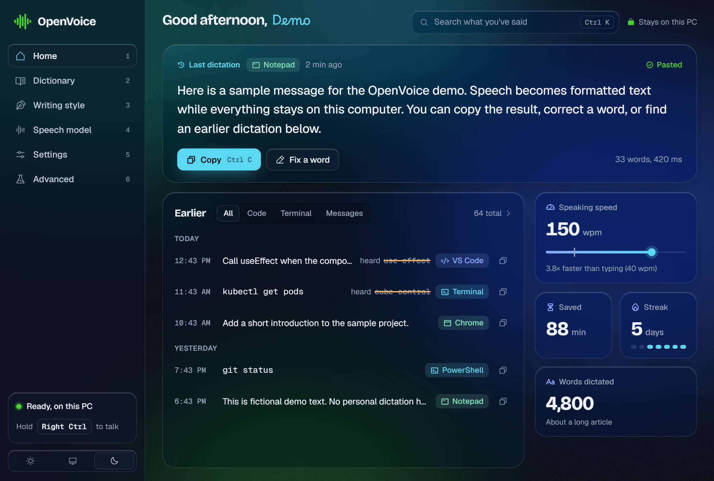

<div align="center">


<br/>

<a href="https://aditya-shelke-portfolio.vercel.app/"></a>
&nbsp;
<a href="https://linkedin.com/in/adityashelke04"></a>
&nbsp;
<a href="mailto:adityashelke04@gmail.com"></a>
&nbsp;
<a href="https://youtube.com/@adityashelke06"></a>

</div>

---

## 👨‍💻 Who I Am

```typescript
const aditya = {
    role:        "Technical Support Engineer Intern @ Karix Mobile",
    shipping:    "OpenVoice — local-first dictation for Windows",
    dayJob:      ["Meta webhook logs", "SMPP error codes",
                  "DLT registration", "delivery-report SQL"],
    writesIn:    ["Rust", "Python", "TypeScript"],
    education:   "Final Year — Information Science & Engineering",
    location:    "Bengaluru, India 🇮🇳",
    lookingFor:  "AI / Systems Engineering roles",
    philosophy:  "If users keep hitting the same wall, build the ladder",
};
```

I spend my days on the support desk of a CPaaS platform, watching the same failures
arrive over and over. Most of what I build starts there — a problem I had to solve by
hand enough times that automating it stopped being optional.

---

## 🎙️ OpenVoice &nbsp;·&nbsp; <sub>flagship</sub>

> **The one I want you to look at.** Local-first push-to-talk dictation for Windows.
> Hold a key, speak, release — correctly formatted text appears at your cursor, in any
> app. No cloud, no account, no telemetry.

<div align="center">

<a href="https://openvoice-dictation.vercel.app">

</a>

<br/>
<sub>OpenVoice v1.3.3 · Captured 30 October 2026 · Synthetic demo text and statistics; no personal history.</sub>

<br/><br/>

<a href="https://github.com/adityashelke04/OpenVoice/releases"></a>
<a href="https://github.com/adityashelke04/OpenVoice/actions/workflows/ci.yml"></a>


</div>

**Whisper transcribes beautifully and formats nothing.** Ask it to transcribe someone
writing code and you get `use effect` for `useEffect`, `cube control` for `kubectl`, and
the literal words "open parenthesis". Those aren't model bugs — they're accurate
transcriptions of what you actually said. Fixing them is a text-processing problem, and
text processing is deterministic, testable, and improvable one rule at a time.

So OpenVoice treats the speech model as a swappable commodity and puts all its effort
into what happens next:

```
you say:   "um so we need to call use effect here comma then return null"
you get:   "So we need to call useEffect here, then return null"

you say:   "cube control get pods"          (a terminal has focus)
you get:   "kubectl get pods"               — no capital, no period. it runs.
```

Both are asserted as tests in the formatter crate, not illustrations. It knows which app
has focus and applies the rules that app deserves. Dictation runs locally, with no
telemetry. Optional model downloads and configurable update checks are the documented
[network exceptions](https://github.com/adityashelke04/OpenVoice#principles); CI checks
the network boundary. [Performance measurements and reference hardware](https://github.com/adityashelke04/OpenVoice#measured-on-the-reference-machine)
are documented alongside the project.

<div align="center">

**[⬇ Download for Windows](https://github.com/adityashelke04/OpenVoice/releases/download/download/OpenVoice-x64-setup.exe)** &nbsp;·&nbsp;
**[Website](https://openvoice-dictation.vercel.app)** &nbsp;·&nbsp;
**[Docs](https://openvoice-dictation.vercel.app/docs)** &nbsp;·&nbsp;
**[Source](https://github.com/adityashelke04/OpenVoice)**

<sub>Alpha, and honest about it: nothing is code-signed yet, so Windows will warn you
about an unknown publisher, and the bundled speech engine is CPU-only.</sub>

</div>

---

## 🧪 The Lab

<sub>Everything else I'm building, ordered by what I'd point a stranger at first.</sub>

<table>
<tr>
<td width="50%" valign="top">

### 🩺 WhatsApp Error → Client Reply
`INTERNAL · APPROVED`

Paste a Meta delivery-failure code, get the root cause, a resolution runbook, and a
client-ready email — in about thirty seconds instead of twenty minutes. 62 curated codes,
role-based access, a full audit trail, and a template fallback so it still works when the
model doesn't.

`FastAPI` `Gemini` `SQLite` `JWT`

</td>
<td width="50%" valign="top">

### 🛡️ Kavach
`HACKATHON BUILD`

Installable web app that tells you whether a message you just received is a scam —
running the model **on your own phone**, offline, with nothing sent anywhere unless you
ask for it. Built for the iQOO Hackathon 2026.

[`Repo →`](https://github.com/adityashelke04/Kavach-iqoo_hackathon) &nbsp; `React 19` `WebLLM` `PWA`

</td>
</tr>
<tr>
<td width="50%" valign="top">

### 📊 XSlicer
`SHIPPED`

Splits oversized spreadsheets into attachment-sized parts entirely inside the browser
tab — no upload, no server, zero network calls enforced by CSP. Boring problem,
satisfying fix.

`JavaScript` `Web Workers` `fflate`

</td>
<td width="50%" valign="top">

### 🚀 Launchpad
`IN DEVELOPMENT`

Job-hunt command center — track applications, parse listings, and stay sane during the
grind.

`Vercel` `Supabase` `Gemini`

</td>
</tr>
<tr>
<td width="50%" valign="top">

### 🌍 PrivLens
`IN DEVELOPMENT`

Global privacy enforcement tracker — GDPR fines, rulings, and regulatory decisions
gathered into one lens.

`Web` `Data`

</td>
<td width="50%" valign="top">

### 💼 Infinity Coins
`IN DEVELOPMENT`

Insurance advisory platform — policy discovery, comparison, and advisor workflows in one
place.

`Web`

</td>
</tr>
</table>

---

## 🛠️ Arsenal

<div align="center">


<br/><br/>


</div>

---

## 📈 Stats

<div align="center">


<br/>


<br/><br/>


</div>

## 🎮 Beyond The Terminal

<div align="center">

**4000+ hours** in competitive FPS — shot-calling, reading a fight, and losing enough
to learn something

Reading about local-first software, ASR pipelines, and how to make slow things fast

*If users keep hitting the same wall, build the ladder*

</div>

<br/>

<div align="center">


</div>
